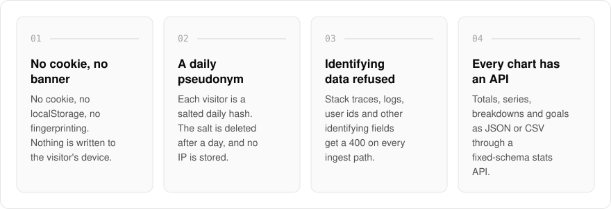
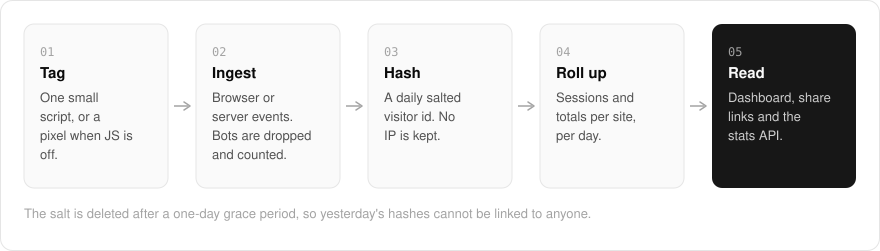

  <picture>
    <source media="(prefers-color-scheme: dark)" srcset=".github/assets/hero-dark.png">
    
  </picture>

<h1 align="center">track.me.at</h1>

<strong>Web analytics with nothing for visitors to consent to.</strong>

  
  
  
  

  <a href="#features">Features</a> ·
  <a href="#how-it-works">How it works</a> ·
  <a href="#screenshots">Screenshots</a> ·
  <a href="#built-with">Built with</a>

Most analytics scripts drop cookies, so the site needs a consent banner before it can count a single pageview. I built track.me.at so there is nothing to consent to: pageviews, referrers, campaign tags and custom events, with no cookie, nothing written to the visitor's device, and no IP address or user-agent stored. Each visitor is a daily pseudonym whose salt is deleted after a day, and the docs say plainly that this is not anonymity. Every number the dashboard charts is also available through a read API.

  <picture>
    <source media="(prefers-color-scheme: dark)" srcset=".github/assets/overview-dark.svg">
    
  </picture>

## Why track.me.at

| The usual analytics script | track.me.at |
| --- | --- |
| Sets cookies, so the site needs a consent banner | Sets no cookie and writes nothing to the device |
| Stores IP addresses and user-agents | Stores a daily hash whose salt is deleted after a day |
| Accepts whatever the page sends | Refuses identifying fields with a 400 |
| Keeps your numbers inside its dashboard | Serves every chart as JSON or CSV |
| Sells "unlimited" plans | States volume, retention and seats as checked numbers |

## Features

- **Nothing stored on the visitor**: no cookie, no localStorage, no fingerprinting, and no `Set-Cookie` on any ingest response.
- **Daily salt deletion**: each day's salt is kept out of exports, logs and backups and deleted after a one-day grace period, so yesterday's hashes cannot be linked to anyone.
- **Identifying data refused**: stack traces, logs, spans, web vitals and caller-supplied user ids are rejected with a 400 on every ingest path.
- **One small script tag**: a versioned, SRI-pinnable tracker plus an auto-updating alias, a `<noscript>` pixel fallback, and an Umami-compatible script and collect route so an existing tag can point at Track unchanged.
- **Server-side ingest**: batched events from backends and edge workers, using a per-site write credential that is separate from the read token.
- **Dashboard and read API**: totals, series, breakdowns and goals for every site on the account, with click-to-filter breakdowns. The same queries are available as JSON or CSV (with formula cells escaped) through a fixed-schema stats API.
- **Public and shared dashboards**: publish a public dashboard at a chosen address or issue a revocable private share link. Both show site-wide totals only.
- **Plain numeric limits**: volume, retention, seats and API access are checked numbers, with an account-wide ceiling above the per-site caps and bot or wrong-origin drops counted separately.

## How it works

  <picture>
    <source media="(prefers-color-scheme: dark)" srcset=".github/assets/flow-dark.svg">
    
  </picture>

A small script (or a pixel when JavaScript is off) sends events from the browser, and backends can send batches with their own write credential. Bots and wrong-origin hits are dropped and counted, then each visitor becomes a hash of the day's salt, the site, the IP and the user-agent, and only the hash is kept. Events roll up into sessions and per-site totals that the dashboard, share links and stats API all read.

## Screenshots

<table>
  <tr>
    <td width="50%"><picture><source media="(prefers-color-scheme: dark)" srcset=".github/assets/hero-dark.png"></picture> The landing page: what Track counts, and what it never stores.</td>
    <td width="50%"><picture><source media="(prefers-color-scheme: dark)" srcset=".github/assets/data-policy-dark.png"></picture> Data policy: how Track handles visitor data, and where its guarantees stop.</td>
  </tr>
</table>

## Built with

  
  
  
  
  
  

- Next.js 16 (App Router), React 19, TypeScript
- Tailwind CSS 4
- Drizzle ORM + Postgres (with a reference driver and a SQLite driver behind the ingest/query seam)
- Better Auth
- oRPC + TanStack Query
- Resend for scheduled email reports
- Self-hostable with Docker

## Part of the me.at family

track.me.at is one of my [`*.me.at`](https://me.at) apps. They share one design system, account, and app shell. Development happens in a private monorepo; this repository is the project's public-facing home.

## License

Source-available. See [LICENSE](LICENSE).
