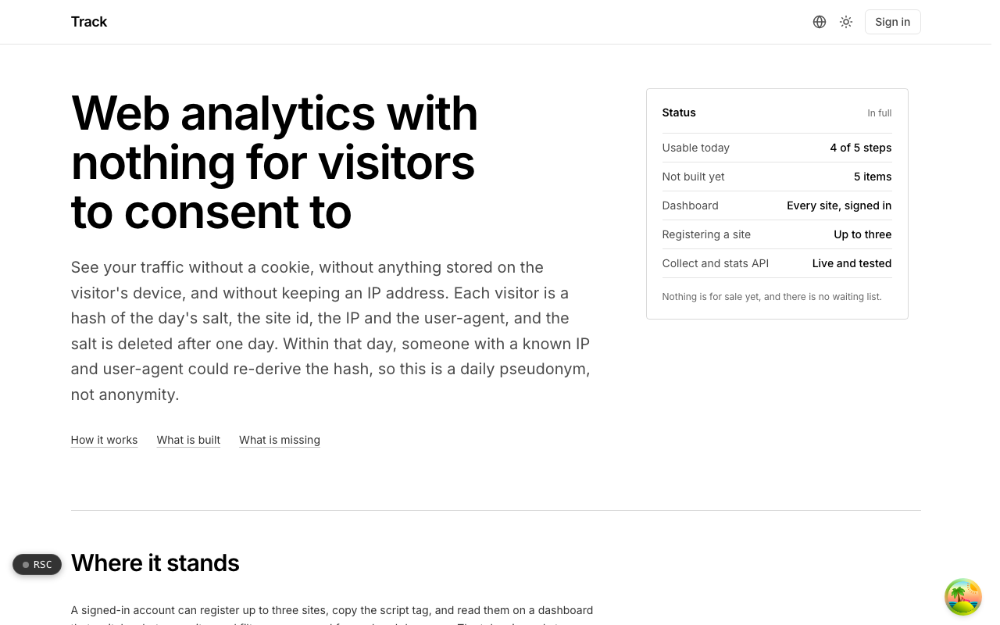
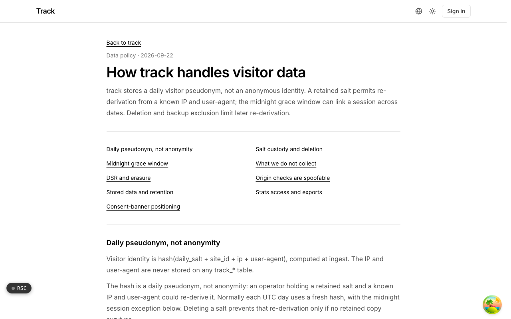

  <picture>
    <source media="(prefers-color-scheme: dark)" srcset=".github/assets/hero-dark.png">
    
  </picture>

# track.me.at

Web analytics with nothing for visitors to consent to.

Track is cookieless site analytics: pageviews, referrers, campaign tags and custom events for the sites you register, with a read API for everything the dashboard charts. It sets no cookie, writes nothing to the visitor's device and never stores an IP address or user-agent. Each visitor is a hash of the day's salt, the site id, the IP and the user-agent, and the salt is deleted after a day, so the stored identifier is a daily pseudonym (and the docs say plainly that it is not anonymity). It is for site owners who want traffic numbers without a cookie banner or session replay creeping in.

## Features

- **Nothing stored on the visitor**: no cookie, no localStorage, no fingerprinting, and no `Set-Cookie` on any ingest response.
- **Daily salt deletion**: each day's salt is kept out of exports, logs and backups and deleted after a one-day grace period, so yesterday's hashes cannot be linked to anyone.
- **Identifying data refused**: stack traces, logs, spans, web vitals and caller-supplied user ids are rejected with a 400 on every ingest path.
- **One small script tag**: a versioned, SRI-pinnable tracker plus an auto-updating alias, a `<noscript>` pixel fallback, and an Umami-compatible script and collect route so an existing tag can point at Track unchanged.
- **Server-side ingest**: batched events from backends and edge workers using a per-site write credential that is separate from the read token.
- **Dashboard and read API**: totals, series, breakdowns and goals for every site on the account, with click-to-filter breakdowns; the same queries are available as JSON or CSV (with formula cells escaped) through a fixed-schema stats API.
- **Public and shared dashboards**: publish a public dashboard at a chosen address or issue a revocable private share link; both show site-wide totals only.
- **Plain numeric limits**: volume, retention, seats and API access are checked numbers, with an account-wide ceiling above the per-site caps and bot or wrong-origin drops counted separately.

## Screenshots

<table>
  <tr>
    <td width="50%"><picture><source media="(prefers-color-scheme: dark)" srcset=".github/assets/data-policy-dark.png"></picture> Data policy: how Track handles visitor data, and where its guarantees stop</td>
  </tr>
</table>

## Built with

- Next.js 16 (App Router), React 19, TypeScript
- Tailwind CSS 4
- Drizzle ORM + Postgres (with a reference driver and a SQLite driver behind the ingest/query seam)
- Better Auth
- oRPC + TanStack Query
- Resend for scheduled email reports
- Self-hostable with Docker

## Part of the me.at family

track.me.at is one of my [`*.me.at`](https://me.at) apps. They share one design system, account, and app shell. Development happens in a private monorepo; this repository is the project's public-facing home.

## License

See [LICENSE](LICENSE).
